# Undertone Sound

<p align="center"></p>

<p align="center">
  <a href="https://github.com/liminal-hq-labs/undertone-sound/actions/workflows/ci.yml"></a>
  
  
</p>

Shared Rust sound core for Undertone.

Undertone Sound is the Rust side of the [Undertone](https://github.com/liminal-hq/undertone) family: one sound grammar for songs and effects, with a renderer per target, from OPL2 and OPL3 chips to the browser. It starts with `oplstream`, the reference implementation of OPX, a small, exact, loopable stream of timed OPL register writes.

> **Status:** experimental, and nothing is released or published. `oplstream` reads, writes, validates and steps OPX, prints and assembles its text twin, and imports IMF, DRO and VGM. `undertone-mini` and `undertone-dsp` are carved out of the studio with their recorded fixtures. `undertone-opl` sequences songs onto the chips, and `undertone-sound` holds the song document, its validation and its compiler. `undertone-wasm` binds them for the browser, and the site has a live demo that imports Title Theme and plays it through an OPL emulator. The [roadmap](docs/ROADMAP.md) lists what comes next.

## What it's for

- Playing music and effects on an AdLib or OPL3 card, or an emulator, from a timer interrupt.
- Converting IMF, DRO and VGM captures to one exact format, and back.
- Writing a composer's tool that lowers songs to chip register writes.
- Keeping a browser renderer and a chip renderer in step from one song.

## Crates

| Crate | What it holds | State |
|---|---|---|
| `oplstream` | OPX reader, writer, stepper, validator, text twin and IMF, DRO and VGM import. The core is `no_std` | Working |
| `undertone-mini` | Undertone's mini-notation and exact fractions | Working |
| `undertone-dsp` | Undertone's voices, Web Audio graph and in-house renderer | Working |
| `undertone-opl` | OPL sequencing and channel allocation | Planned, empty |
| `undertone-sound` | The song document, its validation and formatting, and the compiler to engine-neutral events | Working |
| `undertone-wasm` | WebAssembly bindings and the demo's engine | Working |

## Install and run

From source, with the pinned Rust toolchain:

```sh
cargo test --workspace
cargo run -p oplstream --example oplstream_guide
```

The crates are not published yet.

## Documentation

- [The documentation site](https://liminal-hq-labs.github.io/undertone-sound/) — guides, the OPX specification, the Rust API and a live demo. Its source is in `site/`, and `bash scripts/build-site.sh` builds it
- [SPEC.md](SPEC.md) — behaviour and interfaces
- [docs/OPX.md](docs/OPX.md) — the OPX format
- [docs/ROADMAP.md](docs/ROADMAP.md) — what is built and what is next
- [docs/decisions.md](docs/decisions.md) — decisions and why
- [AGENTS.md](AGENTS.md) — contributor and agent rules

## Contributing

Issues and pull requests are welcome. The house rules are in [AGENTS.md](AGENTS.md); run the checks it lists before opening a pull request.

## Part of Liminal HQ Labs

Undertone Sound is a [Liminal HQ Labs](https://github.com/liminal-hq-labs) experiment. Experiments from Liminal HQ — early, rough and open. If it proves itself, it [graduates](https://github.com/liminal-hq-labs/.github/blob/main/docs/labs-charter.md#graduation) to [Liminal HQ](https://github.com/liminal-hq).

## Licence

Licensed under either of the [Apache License, Version 2.0](LICENSE-APACHE) or the [MIT licence](LICENSE-MIT), at your option.
